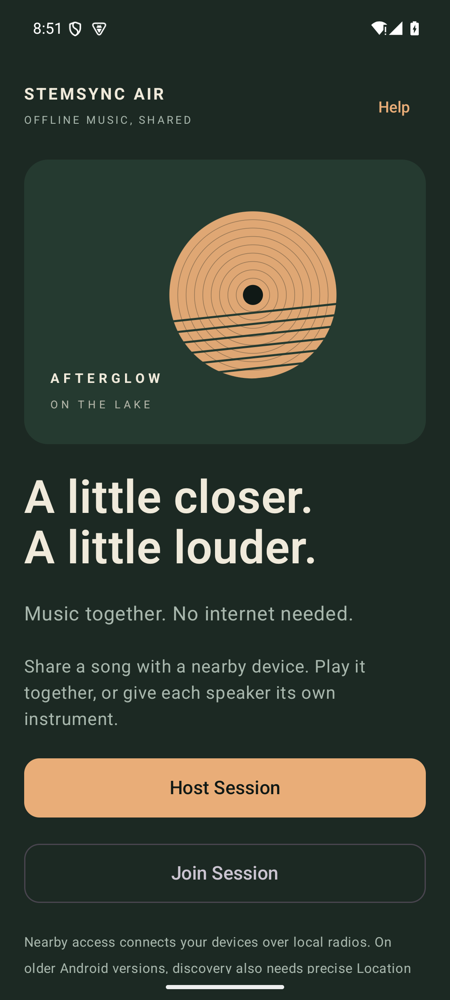
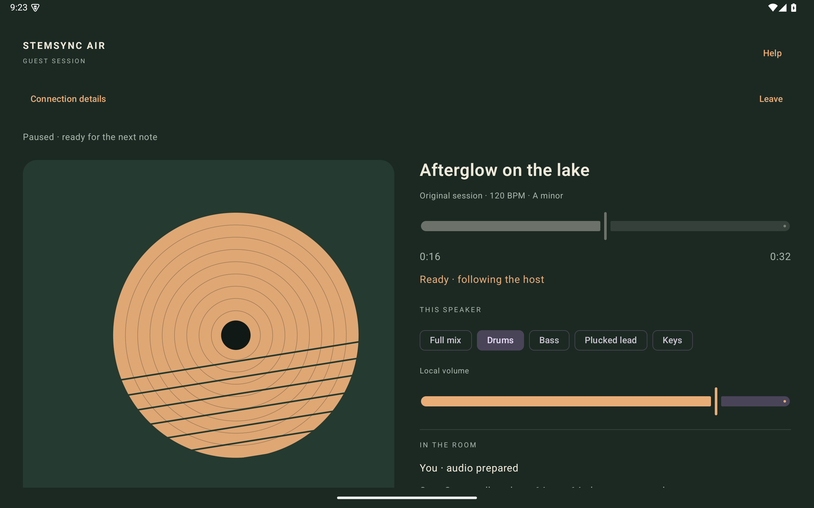

# STEMSYNC AIR

**Your music. Every speaker. Together.**

A guitar part on the phone. Drums on the tablet. The same song, shared over local wireless, with no internet music service in between.

StemSync Air is an Android music project built around a musician's question: can the nearby devices we already have become a coordinated listening system? It combines an original instrumental with local file distribution, clock estimation and a host-controlled playback timeline. It is designed for a guitarist and Electrical Engineering master's student interested in wireless communication and DSP.

**Current version: 0.2.1 — MP3 import added.** Use **Import song / stems**, select one `.mp3` in the system picker, and wait for local preparation before pressing Play. Install the updated APK on both devices.

**Status:** version 0.2.1 installable debug build; implementation and automated validation are documented in [VALIDATION.md](docs/VALIDATION.md). Physical Samsung phone/tablet acceptance and acoustic synchronization remain unverified. No sample-perfect or zero-latency claim is made.



## What it does

- Creates an offline Nearby Connections room with one host and one guest.
- Requires both users to compare and confirm the connection code.
- Transfers real WAV files, verifies byte length and SHA-256, and prepares them locally with Media3.
- Plays the full mix on both devices, or a different aligned instrument on each.
- Gives the host play, pause, seek and stop controls on a shared future timeline.
- Estimates guest-to-host clock offset and RTT, checks logical playback drift, and applies conservative correction.
- Provides explicit reconnect, verified cache reuse, per-device volume and manual speaker-delay adjustment.
- Imports MP3 or WAV songs, or up to six aligned PCM16 WAV stems, using the system file picker.

There is no backend, login, recording feature or commercial music integration. Nearby handles local radio transports; this is not Bluetooth-only transfer or continuous audio streaming.

## Install and listen

Use **stemsync-air-debug.apk** from the delivery folder. Minimum Android version is 10. Google Play services must be installed and working before going offline. Copy the APK to both devices, open it in their file managers and allow installation from that source if prompted. For USB installation:

```sh
adb -s PHONE_SERIAL install -r stemsync-air-debug.apk
adb -s TABLET_SERIAL install -r stemsync-air-debug.apk
adb -s PHONE_SERIAL shell am start -n air.stemsync/.MainActivity
```

1. Turn on Bluetooth and Wi-Fi on both devices. Internet access and mobile data are unnecessary. Older Android versions also need Location enabled for discovery.
2. On the phone, select **Host Session**. On the tablet, select **Join Session**, then the phone's room.
3. Compare the verification codes and choose **Codes match** on both devices.
4. Wait for file transfer, verification, audio preparation and clock synchronization. The original demo is loaded by the host; a fresh guest receives it through the real transfer path.
5. Press **Play together** on the host. Choose **Full mix** for group listening, or different instrument chips for distributed instruments. The host also controls pause and seeking.
6. Keep both apps visible. After a lost connection, restore the radios, tap **Reconnect**, reauthenticate and wait for fresh timing estimates.

For a host-only file test, use **Import song / stems** on the phone with an original file that is absent from the tablet. A single file is a full song. Multiple selected files are treated as stems; they must have identical PCM frame counts and sample rates and already be musically aligned. Supported input: one MP3 or PCM16 WAV song, or aligned PCM16 WAV stems. Standard 8–48 kHz mono/stereo rates are supported. MP3 is decoded locally once into WAV before verification and transfer; both the input and decoded file must fit 100 MiB. Select only one MP3 at a time.

**Help** contains permissions/settings links and a ±300 ms speaker-delay control. Positive delay makes that device later. **Connection details** shows real available observations and exports a diagnostic snapshot. An unavailable measurement stays “Not measured.”

## The original music

*Afterglow on the lake* is a 32-second, 120 BPM, A-minor instrumental built from deterministic synthesis. It has drums, bass, a plucked lead, keys, and a full mix. Every file has 1,411,200 samples at 44.1 kHz. The integer full mix exactly equals the aligned integer stems. No commercial recording or artwork is included.

```sh
python3 -m pip install numpy
python3 tools/generate_demo.py
python3 tools/verify_audio.py
```

The generator and generated assets are included under the project MIT license. The plucked lead can later be replaced by an original guitar recording exported at the same timeline and format.

## Build in Android Studio or from the terminal

Open this folder as the project. Install JDK 17 and Android SDK Platform 36 / Build Tools 35.0.0. Point Android Studio or `ANDROID_HOME` at that SDK. The Gradle wrapper is included, with its official distribution checksum pinned.

```sh
export JAVA_HOME=/path/to/jdk17
export ANDROID_HOME=/path/to/android-sdk
./gradlew assembleDebug testDebugUnitTest lintDebug assembleDebugAndroidTest
./gradlew connectedDebugAndroidTest    # requires a running device/emulator
```

The built APK is `app/build/outputs/apk/debug/app-debug.apk`. First-time dependency resolution requires internet; using the installed app does not require an application server. Pinned stable dependencies are listed in the build files. The tested toolchain uses Gradle 8.13, AGP 8.13.2, Kotlin 2.3.20, Nearby 19.3.0 and Media3 1.9.4. Version-update lint warnings are retained rather than hidden.

## Architecture and synchronization

`SessionViewModel` coordinates a StateFlow UI, Nearby transport, private audio library and Media3 player. The pure Kotlin `core` package contains protocol validation, connection consent, transfer-order gating, the clock estimator, timeline store and drift controller. Compose uses a scrollable phone layout and a two-column player at tablet widths.

For guest send/receive timestamps t1/t4 and host receive/send timestamps t2/t3:

```
hostMinusGuest = ((t2 - t1) + (t3 - t4)) / 2
networkRTT    = (t4 - t1) - (t3 - t2)
```

All timestamps use monotonic nanoseconds. The estimator prefers recent low-RTT samples and slews active updates. Playback readiness also requires five recent samples, RTT ≤150 ms, a network uncertainty budget ≤75 ms and a latest sample ≤2.5 seconds old. These conservative thresholds do not describe acoustic accuracy. The host schedules transitions one second ahead; guests translate the shared host timeline using their offset estimate. A revision prevents older playback commands from overwriting new ones. Drift is evaluated against Media3's player position, with bounded speed correction and occasional sustained-error seeks.

These estimates are affected by asymmetric links, callback scheduling, decoder behavior and unknown speaker latency. See [ENGINEERING.md](docs/ENGINEERING.md) for equations, sign conventions, permission decisions, transfer safety, lifecycle behavior and trade-offs.



## Validation and limitations

See [the validation record](docs/VALIDATION.md), [Samsung acceptance procedure](docs/HARDWARE-TEST.md), and [performance evaluation method](docs/PERFORMANCE.md). Automated synthetic timing tests do not demonstrate physical audio alignment. A real two-device test is still required.

- One host plus one guest; additional guests are explicitly declined.
- Foreground operation only. Backgrounding pauses output; no foreground playback service is claimed.
- MP3 songs are converted locally to PCM WAV; longer songs may exceed the 100 MiB decoded limit. Multiple-file stem imports must be aligned WAVs. The app does not separate instruments from a mixed song.
- Switching stems can produce a preparation gap. Scheduling is soft, with 20 ms polling; speaker onset is not sample-accurate.
- Transfer retry restarts from zero. A partition near a scheduled start can leave the host playing alone.
- Private files persist for reconnect/replay within the session; there is no full library browser or cache management screen yet. Clearing app storage removes them.
- Calibration is per device and currently resets when the app process restarts.
- Diagnostic export is a snapshot rather than a continuous raw timestamp trace.
- No physical discovery, throughput, reconnect or acoustic measurements have been fabricated.

Next useful work is Samsung validation, raw diagnostic traces, measured calibration, persistent library controls, and only then extending the participant count or considering continuous streaming.

## License

Project code, original synthesis and demo assets: [MIT](LICENSE). AndroidX libraries retain their respective licenses; Google Play services is subject to Google's SDK terms and is not made open source by this repository. See [third-party notes](docs/THIRD-PARTY.md).
